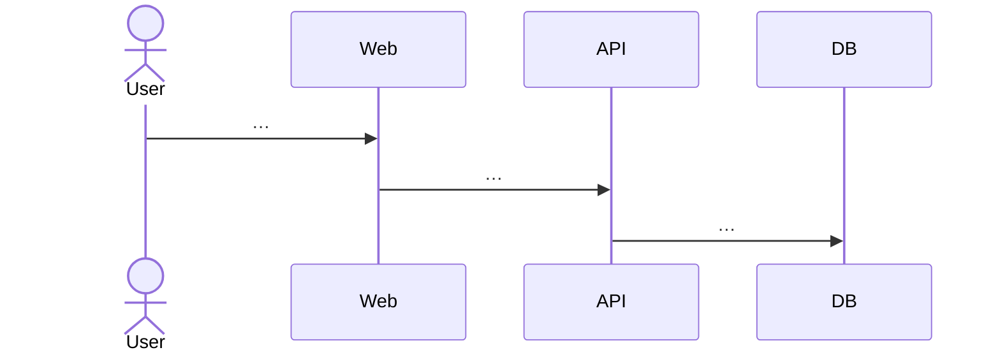

# Design — [Feature name]

Status: Draft
Stories: US-###, US-###
ADRs: ADR-#### (new or existing)

## 1. Overview
[What we're building in 3–5 sentences, and the main trade-off.]

## 2. UI
For each screen:
### [Screen name] (route `/…`)
- Purpose: [ ]
- Components: [from src/design/components/]
- States: loading · empty · error · partial · success — describe each; mark ★ for those needing a visual test
- Copy: [exact strings, or `[COPY: …]` for the user to supply]
- Accessibility: [focus order, labels, live regions]
- Serves: AC-###.#, AC-###.#

## 3. API contract
| Method | Path | Request (Zod) | Response | Errors | Auth |
|---|---|---|---|---|---|
| POST | /api/… | `{ … }` | `201 { … }` | 400 VALIDATION, 409 CONFLICT | signed-in owner |

## 4. Data
- Tables / columns / indexes: [ ]
- Migration: [expand → migrate → contract if destructive]
- Personal data stored, why, retention: [ ]

## 5. Flows

[Main failure path diagram too.]

## 6. LLM use (if any)
- Model and provider: [ ] · Prompt file: `src/agents/prompts/…`
- Input / output schema: [ ] · Max tokens, timeout, retry: [ ]
- Evals to add: [dataset, scorer, threshold] · Cost per call (estimate): [ ]

## 7. Threats
| Threat | Where | Mitigation |
|---|---|---|
| [Spoofing / Tampering / Repudiation / Info disclosure / DoS / Elevation; prompt injection] | | |

## 8. Observability
- Log events: `[domain.action]` with fields …
- Metrics: [ ]
- SLO: [SLI] [objective] over [window] · Alert: [burn-rate rule] · Runbook entry: [ ]

## 9. Traceability
| AC | Design element(s) | Test level |
|---|---|---|
| AC-###.1 | [screen/endpoint] | unit / integration / e2e / visual / eval |

## 10. Open questions
- [ ]
